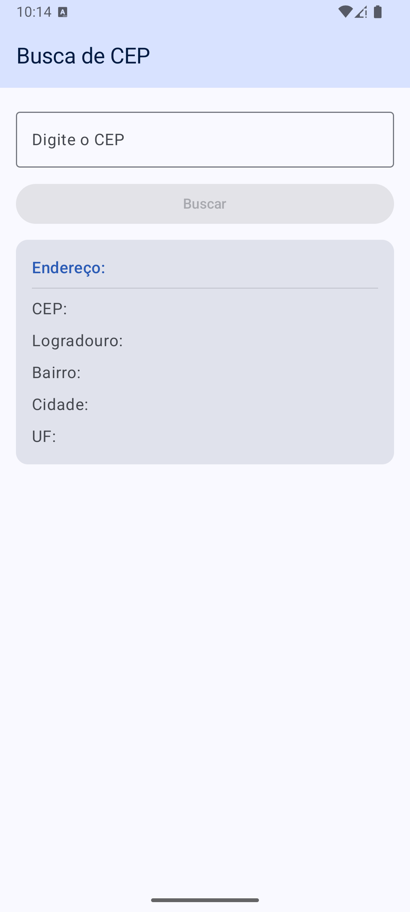
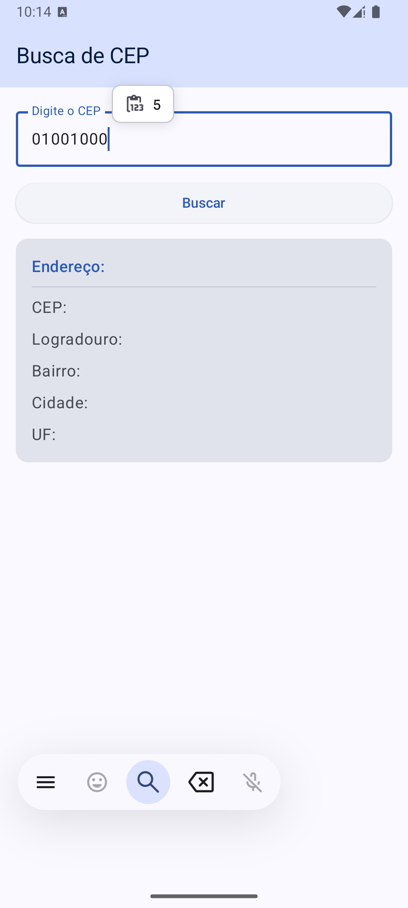
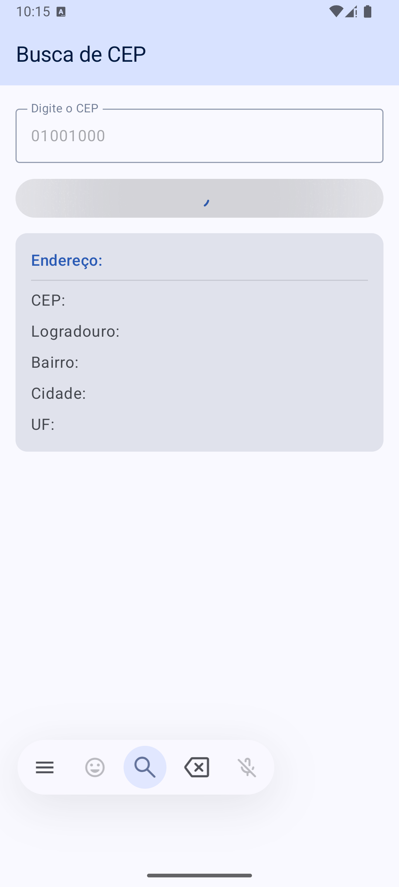
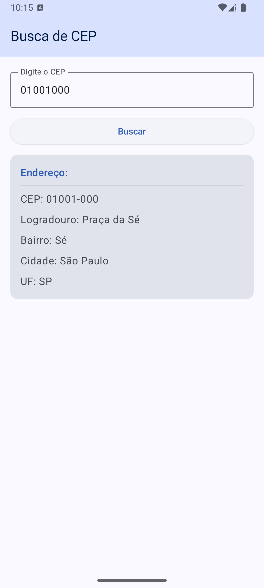
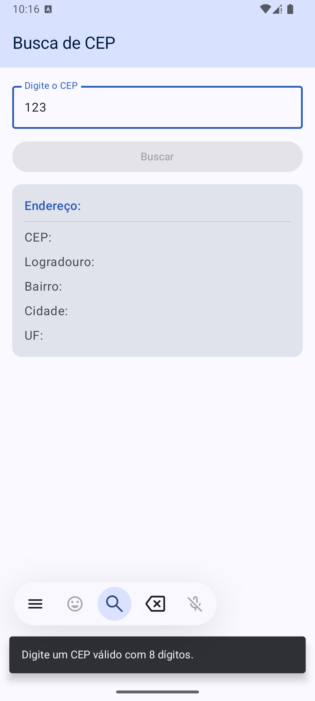
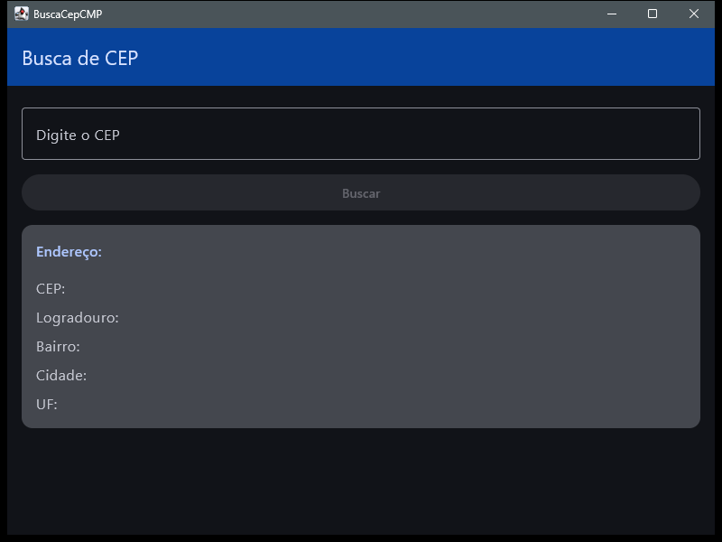
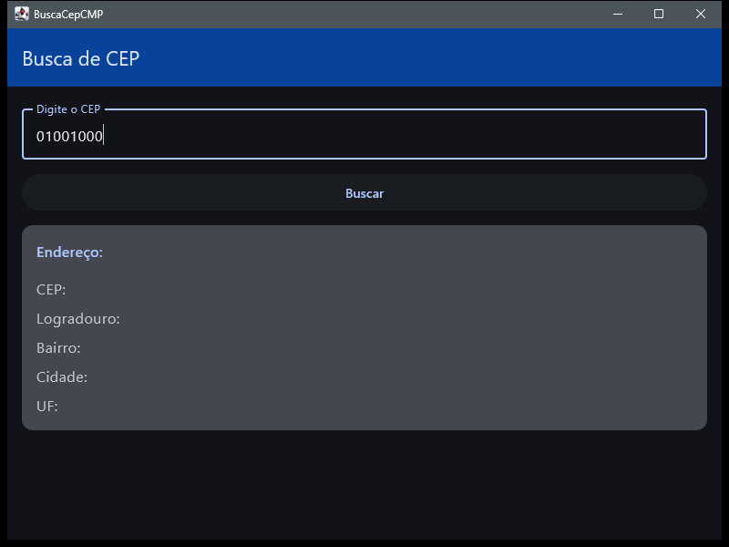
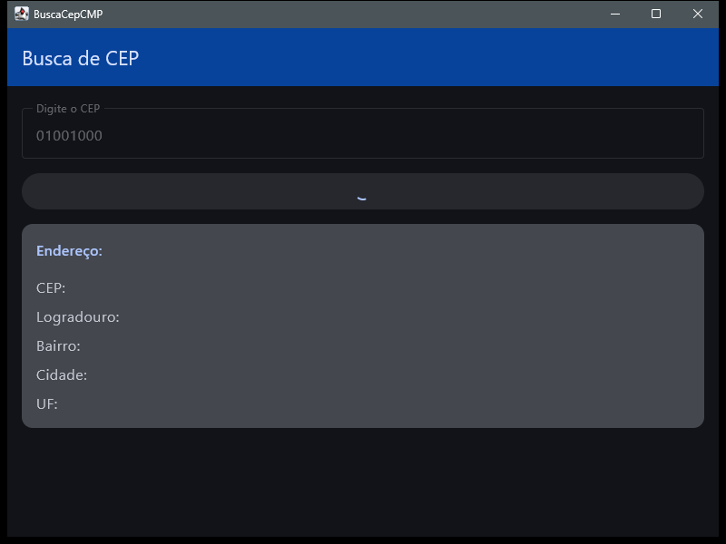
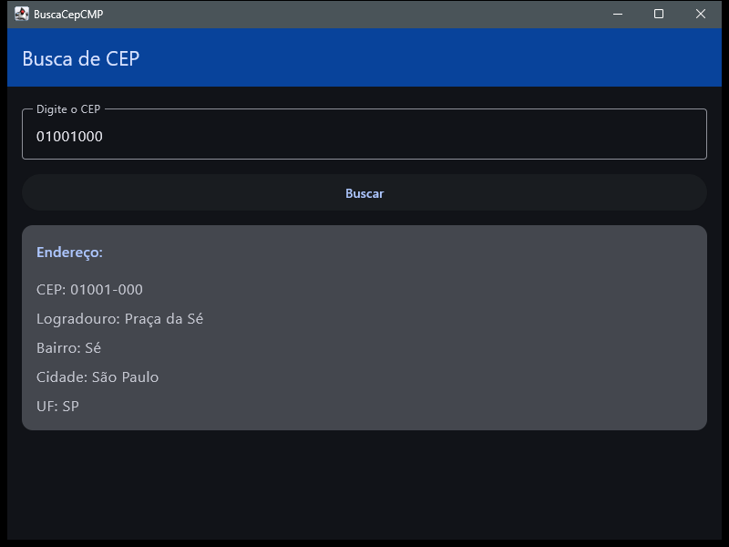
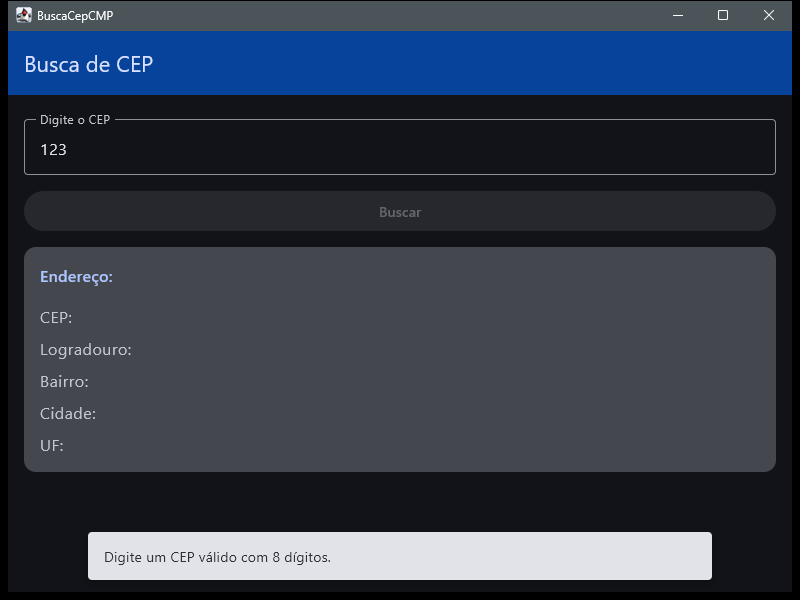

# Atividade Final - BuscaCepCMP

Aplicativo Kotlin Multiplatform (Android + Desktop) desenvolvido como atividade final da disciplina de **Arquiteturas e Padrões Modernos para Desenvolvimento para Dispositivos Móveis (KMP)** — busca de endereço a partir do CEP, consumindo a API pública ViaCEP, com toda a interface compartilhada via Compose Multiplatform.

---

## 📝 Descrição da Atividade

**Trabalho Final — Arquiteturas e Padrões Modernos para Dispositivos Móveis (KMP)** (trabalho individual)

O objetivo é avaliar a capacidade de criar aplicações utilizando Kotlin Multiplatform (KMP) e Compose Multiplatform (CMP). O enunciado pede uma aplicação de busca de CEP com UI compartilhada entre, no mínimo, Android e Desktop, consumindo a API ViaCEP através de um cliente HTTP multiplataforma (Ktor), com uma `ViewModel` gerenciando o estado da tela e da chamada de rede, e tratando corretamente os estados de carregamento, sucesso e erro.

---

## ✅ Critérios da Especificação Atendidos

| # | Critério | Peso | Implementação |
| --- | --- | --- | --- |
| 1 | Consumo da API ViaCEP via Ktor (Logradouro, Bairro, Localidade, UF) | 2,0 | `ViaCepApiImpl` faz `GET https://viacep.com.br/ws/{cep}/json` com Ktor; `EnderecoResponse` (DTO serializável) converte para o modelo de domínio `Endereco` via `toDomain()`. |
| 2 | `OutlinedTextField` para entrada do CEP | 0,5 | Campo numérico em `BuscaCepScreen`, com entrada sanitizada (somente dígitos, máx. 8) na `ViewModel`. |
| 2 | `ElevatedButton` desabilitado até CEP válido | 0,5 | Botão habilitado apenas quando `cepInput.length == 8` e a consulta não está em andamento. |
| 2 | Cinco `Text` para o resultado | 0,5 | `EnderecoCard` exibe CEP, Logradouro, Bairro, Localidade (Cidade) e UF. |
| 3 | `ViewModel` gerenciando estado e chamadas à API | 2,0 | `BuscaCepViewModel` expõe `StateFlow<BuscaCepUiState>` e dispara a busca via `viewModelScope`, escopada ao ciclo de vida da tela (`viewModel { }`). |
| 4 | Ao consultar: limpar resultado, desabilitar campo e botão, exibir progresso circular no botão | 1,5 | Estado `Loading` zera o resultado exibido e desabilita `OutlinedTextField`/`ElevatedButton`; o botão passa a exibir `CircularProgressIndicator` no lugar do texto. |
| 5 | Ao concluir: exibir os 5 campos, reabilitar campo e botão, voltar o texto do botão | 1,5 | Estado `Success` preenche o `EnderecoCard` e devolve `enabled = true` ao campo e ao botão. |
| 6 | Erro exibido via `Snackbar` | 1,5 | Estado `Error` dispara `snackbarHostState.showSnackbar(...)` em um `LaunchedEffect(uiState)`, cobrindo tanto falhas de rede/CEP inexistente quanto validação local (CEP incompleto). |

---

## 🛠️ Tecnologias e Dependências

- **Linguagem:** Kotlin Multiplatform (Android + Desktop/JVM, UI 100% compartilhada)
- **UI:** Compose Multiplatform + Material 3
- **Arquitetura:** MVVM (ViewModel + `StateFlow`) com camadas `domain` / `data` / `ui`
- **Rede:** Ktor Client (core, content negotiation, logging), engine OkHttp em Android e JVM
- **Serialização:** kotlinx.serialization (JSON)
- **Estado assíncrono:** Kotlin Coroutines
- **Lifecycle:** `androidx.lifecycle` multiplatform (`viewmodel-compose`, `runtime-compose`) para escopar a `ViewModel` ao `ViewModelStore` em vez da composição

---

## 🏗️ Organização do Projeto

- **domain**: `Endereco` (modelo de domínio) e `CepRepository` (contrato), sem dependência de Ktor ou Compose.
- **data**: `remote/ViaCepApi` + `ViaCepApiImpl` (Ktor) e `model/EnderecoResponse` (DTO) na camada de rede; `repository/CepRepositoryImpl` implementa o contrato de domínio e trata CEP inexistente (`erro: "true"`) como falha.
- **ui**: `BuscaCepViewModel` (estado e orquestração), `BuscaCepUiState` (`Loading` / `Success` / `Error`), `BuscaCepScreen` (tela) e `ui/components/EnderecoCard` (cartão de resultado); `ui/theme` com o `MaterialTheme` do app.

---

## 📱 Funcionalidades Implementadas

- [x] Busca de CEP consumindo a API ViaCEP via Ktor
- [x] Validação do CEP (8 dígitos) antes de habilitar a busca
- [x] Estado de carregamento: campo e botão desabilitados, indicador de progresso circular no botão
- [x] Exibição do resultado (CEP, Logradouro, Bairro, Localidade e UF) ao concluir a busca
- [x] Mensagem de erro via `Snackbar` (CEP inválido, inexistente ou falha de rede)
- [x] Interface única compartilhada entre Android e Desktop via Compose Multiplatform

---

## 🚀 Como executar

- **Android:** `./gradlew :androidApp:assembleDebug`
- **Desktop:**
  - Hot reload: `./gradlew :desktopApp:hotRun --auto`
  - Execução padrão: `./gradlew :desktopApp:run`

---

## 📸 Imagens do Projeto

Mesma interface Compose Multiplatform rodando em Android e Desktop.

### Android

  
  
  
  
  

### Desktop

  
  
  
  
  

---

Saiba mais sobre [Kotlin Multiplatform](https://www.jetbrains.com/help/kotlin-multiplatform-dev/get-started.html).
